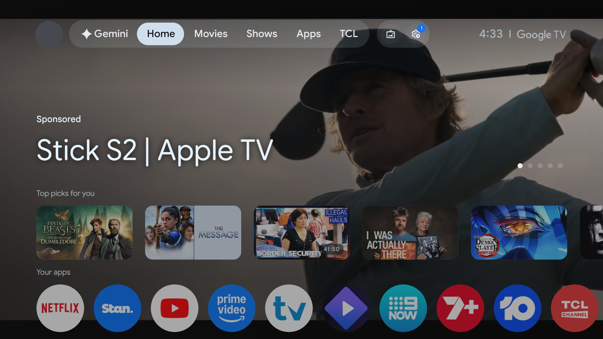
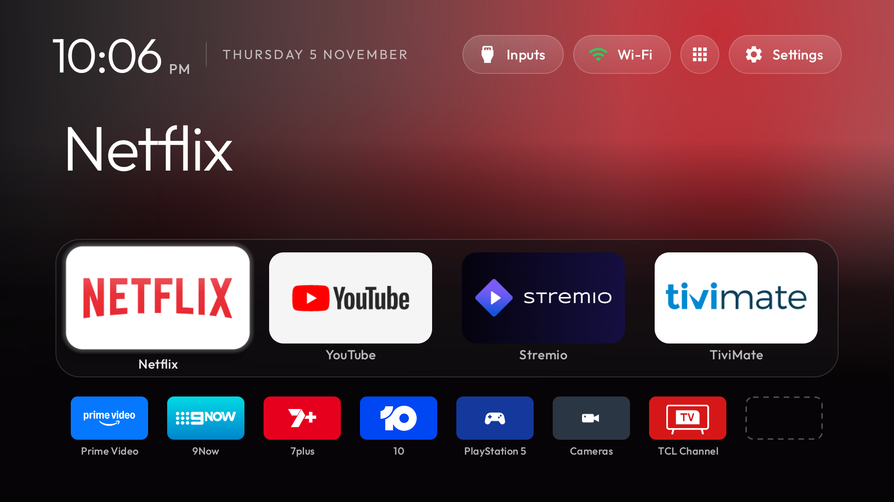
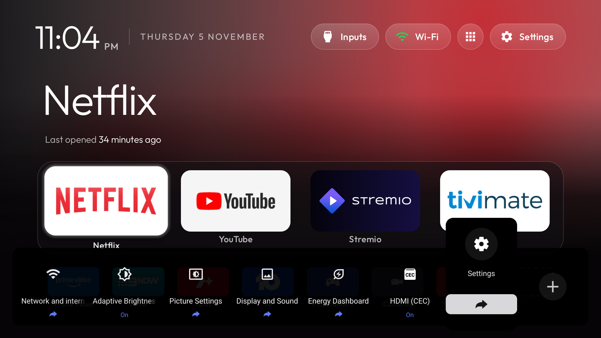

# TCL Google TV clean-up kit (TCL 75C755)

Everything needed to turn a TCL C755 Google TV from an ad-filled Google TV home into a fast, clean, ad-free one, the
way it was done on a 75C755 in November 2026. Every step can be undone, nothing is uninstalled from the TV's
system, and no root is used.

> [!WARNING]
> **This kit was built and tested on one TV, with the exact versions below.** The package list, button codes,
> HDMI input IDs, TCL services and the two APKs were all verified on *this* model and firmware. Another model,
> size, region or firmware (even a later update of this one) can differ. **Check your TV against this table first**
> ([how](docs/01-before-you-start.md#check-your-tv-against-ours)), and wherever anything differs, verify each step's
> facts on your TV before applying it.
>
> | | Built and tested with |
> |---|---|
> | TV | TCL **75C755** QD-Mini LED (device `G08`, MediaTek `tcl9618`), Australian model |
> | Software | Google TV / Android **14** (SDK 34), firmware **`tcl9618-user 14 UTT2.250416.001 AU02`**, security patch **2025-12-05** |
> | Remote | TCL Bluetooth voice remote with Netflix, YouTube, Prime Video, Disney+, Stan, TCL and four colour buttons |
> | CleanYourTV | upstream commit **`04aec4b7`**, launcher **3.3** + [our two patches](cleanyourtv/README.md) |
> | TV Buttons | **2.1** (Media3 **1.4.1**) |
> | Cameras | Dahua 4-channel recorder (DMSS app), RTSP sub-stream H.265 704×576 |
> | Network | TP-Link Deco mesh; TV, PC and recorder on the main network |
> | PC | Windows 11, Python 3.14, Microsoft OpenJDK 17, Android SDK platform 34 / build-tools 34.0.0 |

| Before | After |
|---|---|
|  |  |

## What you end up with

- **No ads or promos.** 31 TCL and Google packages are disabled, plus Google TV's home itself: tracking (Samba TV
  viewing data, TCL analytics), promo pushes, retail demo, AirPlay/Miracast, Google's promo screensaver. Disabled,
  never uninstalled.
- **A new Home screen** ([CleanYourTV](https://github.com/Gathin23/cleanyourtv) launcher, plus three small changes
  of our own): your four favourite apps as big tiles, every other app in one row of half-size tiles, an empty slot
  shown as a dashed outline, names under every tile, a soft glow in the focused app's colour, and a clock.
  It opens instantly. PS5, Cameras and TCL Channel are tiles too, and each switches input in one press.
- **The remote does what it says**, with held volume still ramping smoothly. A small app of ours, *TV Buttons*,
  maps:

  | Button | Does |
  |---|---|
  | YouTube, Prime Video, Netflix | open those apps again (they went dead with Google TV's home) |
  | gear | TCL's own ad-free quick-settings bar (picture, sound, network, …) |
  | TCL | TCL Channel |
  | Disney+ | PlayStation 5 (HDMI 4) |
  | Stan | the camera recorder's screen (HDMI 2) |
  | yellow, blue | a live camera picture in a corner, over anything, PS5 included |

- **Still working:** Chromecast, the Google Assistant / Gemini mic, the game bar, TCL Channel and Play Store. The
  TV boots straight into the new Home, and firmware updates are installed by hand when you choose.

## How to use this kit

**With an AI coding agent (recommended).** Open this folder in Claude Code (or any agent that reads `AGENTS.md`)
and say: *"Set up my TV with this kit. Follow AGENTS.md."* The agent works through the guide with you, checks
your TV against ours at every step, asks before every change, and keeps a log of what it changed.

**By hand.** Follow the guide in order. Every command is written out.

| Step | Guide |
|---|---|
| 1 | [Before you start: PC, TV, network, first connection](docs/01-before-you-start.md) |
| 2 | [Back up the original state](docs/02-backup.md) |
| 3 | [Remove the ads and bloat](docs/03-debloat.md) |
| 4 | [The new Home screen: launcher and theme](docs/04-launcher-and-theme.md) |
| 5 | [Make it Home](docs/05-home-takeover.md) |
| 6 | [Remote buttons (TV Buttons)](docs/06-remote-buttons.md) |
| 7 | [Camera overlay (Dahua/DMSS recorders)](docs/07-camera-overlay.md) |
| 8 | [Afterwards: firmware updates, undo, maintenance](docs/08-maintenance-and-undo.md) |
| | [Everything we learned, decided and ruled out](docs/09-learnings.md) |
| | [Run sheet: one-page checklist](docs/run-sheet.md) |

Allow an evening. The steps that touch the TV take about an hour, plus time to choose apps and arrange tiles.
**Do it while nobody needs the TV:** it restarts a few times and switches screens on its own.

## Is my TV close enough?

Probably, but **don't assume it: check** (see the warning above). Other sizes of the C755 (55, 65, 85, 98) are likely
to run very similar software, and other recent TCL Google TVs are close, but "likely" isn't "verified": regional
firmware and updates change package names, button codes and services. Step 1 compares your TV with ours: model,
firmware, and every package, button code and input this kit relies on. Wherever yours differs, the guide says what
to check and what to change, and the TV Buttons mappings can be adapted without rebuilding anything.

## What's in here

| Folder | What |
|---|---|
| [`docs/`](docs/) | The guide, the learnings, the run sheet |
| [`apks/`](apks/) | Ready-built apps: the launcher (with our changes) and TV Buttons. No build tools needed |
| [`cleanyourtv/`](cleanyourtv/) | How to get upstream CleanYourTV (its tools do the safe work), our launcher patches, and our debloat list |
| [`theme/`](theme/) | The Home screen design: `config.json`, NASA wallpapers, notes |
| [`tv-buttons/`](tv-buttons/) | Source of TV Buttons (remote buttons, gear panel, Back guard, camera overlay) and its `mappings.example.txt` |
| [`tools/`](tools/) | `backup_tv.py` (read-only original-state backup), `record_keys.py` (which code each remote button sends) |
| [`images/`](images/) | Screenshots used in the docs |

## Safety in one paragraph

Nothing is uninstalled from the system and nothing is flashed: packages are *disabled* for the main user, which a
single command (or TV Settings → Apps) reverses. The original state is backed up before the first change. The
CleanYourTV tools refuse lists that touch packages the TV needs, keep Google TV's home until the new one is
proven, and write their own undo record. [Step 8](docs/08-maintenance-and-undo.md) has the one command that puts
everything back. The worst realistic outcome is a factory reset. That re-enables everything, but erases accounts
and installed apps, so it's a last resort and never needed so far.

## Credits and licences

- [CleanYourTV](https://github.com/Gathin23/cleanyourtv) by Gathin23, MIT
  ([licence](cleanyourtv/LICENSE-CleanYourTV)): the launcher, the debloat tools and the C755 package list this kit
  starts from.
- [Media3](https://developer.android.com/media/media3) by Google, Apache 2.0: the video player inside TV Buttons.
- NASA photographs, public domain: see [`theme/CREDITS.md`](theme/CREDITS.md).
- TV Buttons, the launcher patches, the theme and these docs: written for this kit.
