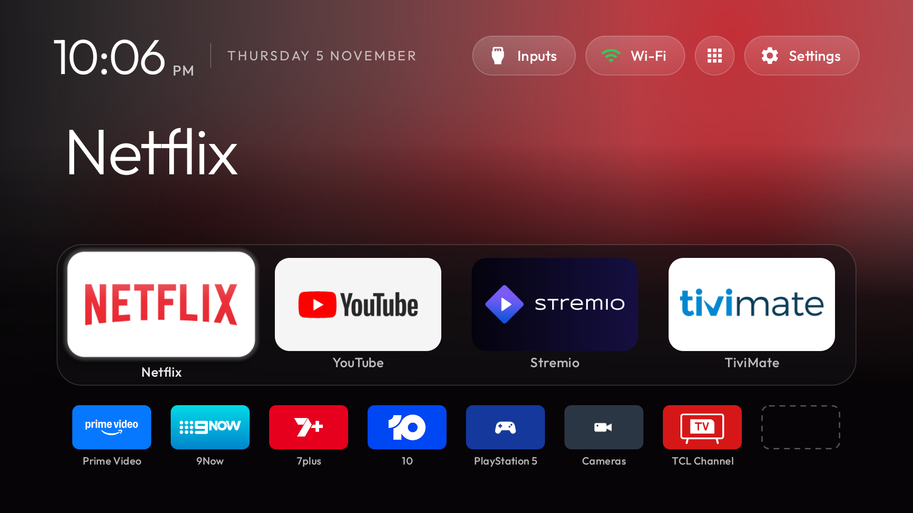

# 4. The new Home screen: launcher and theme



## The design, and why

The brief was: **fast and responsive, no ads or bloat, sleek and modern, clear, intuitive, immersive. Every app
recognisable at a glance, and anyone can look at the screen and know what everything does.** How the design
answers it:

| Choice | Why |
|---|---|
| **CleanYourTV launcher** (`com.gathin.tvhome`) | Opens instantly, no network permission (it *can't* show ads or track), built for 1 GB TVs. Google TV's home loads rows of promoted content from the internet. |
| **Four big favourites** (the "dock"): Netflix, YouTube, Stremio, TiviMate | The apps used most are one press away and impossible to miss |
| **Everything else in one row of half-size tiles** (`half_grid`, our change) | No scrolling and no hidden second page: the whole TV fits on one screen |
| **A dashed outline in the free slot** (our change) | Shows there's room for one more, and keeps the row looking evenly spaced |
| **Names under every tile** (`always_show_names`) | A logo-only banner is never ambiguous; non-tech users read the word |
| **Cinematic glow** (`cinematic_home`): the focused favourite's colour softly fills the top, with its name in large type | Immersive and calm, with no video, blur or downloaded artwork |
| **White glass focus, no bounce** | Easy to follow from across the room |
| **PS5, Cameras, TCL Channel as tiles** | Inputs are things you watch; one press switches, with no Inputs menu to learn |
| **Clock + labelled pills** (Inputs, Wi-Fi, apps grid, Settings), no greeting | Everything on screen says what it is |
| **App Library** behind the grid button | Rarely used apps stay one press away without cluttering Home |
| **Photo wallpaper as an on-TV toggle** | NASA photos of Earth from orbit for anyone who prefers them; the default stays the calm glow |

The theme is [`theme/config.json`](../theme/config.json); [`theme/README.md`](../theme/README.md) explains every
key. The launcher's own options are in upstream's `themes/README.md`.

## Our three launcher changes

`apks/cleanyourtv-launcher-3.3-tcl-c755.apk` is upstream 3.3 plus [two patches](../cleanyourtv/README.md):

1. **Console and camera banners** (`banner_console`, `banner_cameras`): a controller on deep blue and a video
   camera on slate, for the PS5 and Cameras tiles (otherwise they'd show TCL's "Quick panel" artwork).
2. **One Move moves one tile.** Upstream's Move (hold OK on a tile → Move) stays in reorder mode until Back is
   pressed twice, which confused us more than once. Now a Move chosen from the tile menu ends once the tile is
   placed. Settings → Reorder apps still moves many.
3. **`half_grid`:** rows under the dock hold twice as many half-size tiles, the dock tiles span two columns, D-pad
   and reorder use dock-aware row maths, and `HalfGridSlots` draws dashed outlines in free slots (drawn only, never
   focusable). Tested: 20/20 D-pad moves from every edge, reorder within the row and between dock and row; all 314
   upstream unit tests pass.

The APK is 590,965 bytes, 1,141 over upstream's 576 KB size gate, so it isn't a PR candidate. It's fine on the TV.

## Install it as an app first (Google TV stays Home)

Try the launcher, push the theme and arrange the tiles while Google TV is still Home. Step 5 makes it Home.

```powershell
# from CleanYourTV; use the prebuilt APK (or build it: cd launcher; .\gradlew.bat assembleRelease)
mkdir -Force launcher\app\build\outputs\apk\release | Out-Null
copy ..\tcl-tv-kit\apks\cleanyourtv-launcher-3.3-tcl-c755.apk launcher\app\build\outputs\apk\release\app-release.apk
$env:SKIP_BUILD = '1'
powershell -ExecutionPolicy Bypass -File launcher\build-and-install.ps1 -TvHost $env:TV_HOST -StockLauncher none
# -StockLauncher none leaves Google TV enabled, but the script still hands Android's Home *role* to the new
# launcher. Give it back so Google TV stays Home until step 5:
tools\venv\Scripts\python.exe -I tools\tv.py "cmd role add-role-holder --user 0 android.app.role.HOME com.google.android.apps.tv.launcherx"
tools\venv\Scripts\python.exe -I tools\tv.py "cmd role get-role-holders --user 0 android.app.role.HOME"   # -> launcherx
```

Open it from Google TV's Apps row ("CleanYourTV") whenever you want to look at it.

## Adapt the theme to your household

Edit a copy, `..\tcl-tv-kit\theme\config.json` (or copy the folder first):

1. **`dock_apps`**: your four favourites, by package name. List installed apps with
   `tv.py "pm list packages -3"`. Ours: `com.netflix.ninja`, `com.google.android.youtube.tv`, `com.stremio.one`,
   `ar.tvplayer.tv` (TiviMate).
2. **`hidden_apps`**: apps kept off Home (still in the App Library). Ours hides regional apps we don't use,
   Settings and Play Store (they're in the top bar / library), and `local.tvbuttons` (TV Buttons' setup screen).
3. **Input tiles.** These reuse two TCL entries that already sit in the app list (`com.tcl.suspension` and
   `com.tcl.dashboard`, which otherwise open TCL's own source bar). Each gets a name (`app_labels`), artwork
   (`app_banners`) and an input to switch to (`launch_actions`):

   ```json
   "app_labels":     ["com.tcl.tv=TCL Channel", "com.tcl.suspension=PlayStation 5", "com.tcl.dashboard=Cameras"],
   "app_banners":    ["com.tcl.suspension=banner_console", "com.tcl.dashboard=banner_cameras"],
   "launch_actions": ["com.tcl.suspension=input:com.tcl.tvinput/.TvPassThroughService/HW18",
                      "com.tcl.dashboard=input:com.tcl.tvinput/.TvPassThroughService/HW16",
                      "com.tcl.tv=input:com.tcl.channelplus/com.tcl.iptv.service.InputService"]
   ```

   On ours, `HW15`…`HW18` are HDMI 1…4 (PS5 on HDMI 4 = `HW18`, cameras on HDMI 2 = `HW16`). Find yours in the
   backup's `tv-inputs.txt` (each `…TvPassThroughService/HWnn` with its HDMI port), then press the tile to confirm.
   No console or cameras? Remove that tile's three lines and add its package to `hidden_apps`.
4. **TCL Channel tile:** `com.tcl.tv` alone resumes *whichever input was used last* (it opened the cameras for
   us once), so `launch_actions` points it at the TCL Channel input itself.
5. Leave the rest. `live_tv_package` must stay `com.tcl.tv`, the only app that plays HDMI and TV inputs on this TV.

Push it, and push again after every edit:

```powershell
powershell -ExecutionPolicy Bypass -File tools\theme.ps1 -TvHost $env:TV_HOST ..\tcl-tv-kit\theme
# back to the launcher's built-in look:  ... tools\theme.ps1 -TvHost $env:TV_HOST -Reset
```

## Arrange the tiles (on the TV)

The order isn't in the theme: set it on the TV with the remote. **Hold OK on a tile → Move**, use the arrows, then
OK (or Back) to drop it. Many at once: Settings pill → Reorder apps (Back twice to finish). The order is saved on
the TV.

Ours: dock **Netflix, YouTube, Stremio, TiviMate**; row **Prime Video, 9Now, 7plus, 10, PlayStation 5, Cameras,
TCL Channel**, with the dashed eighth slot.

## On-TV options

| Want | How |
|---|---|
| A photo instead of the glow | Settings pill, hold OK → Launcher settings → Wallpaper → pick a photo. "Theme default" returns to the glow |
| Fewer effects (if focus ever feels slow) | Launcher settings → turn off advanced effects |
| Undo every on-TV choice | Launcher settings → Follow theme |

Next: [5. Make it Home](05-home-takeover.md)
