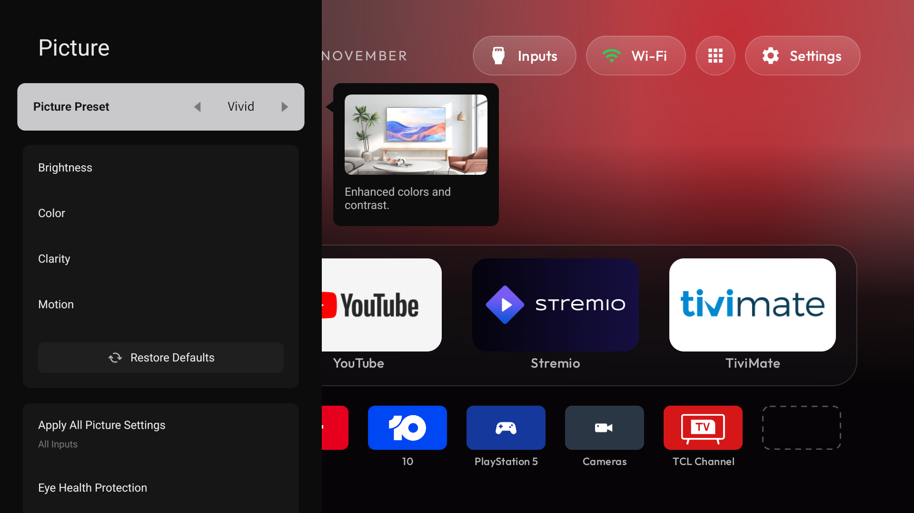

# 6. Remote buttons (TV Buttons)

After step 5, YouTube, Prime Video, Netflix, the gear and the TCL button do nothing, and Stan, Disney+ and the colour
buttons were never useful. **TV Buttons** (`apks/tv-buttons-2.1.apk`, source in [`tv-buttons/`](../tv-buttons/))
gives them all a job **without breaking held volume**.

## Why this needed its own app

**The obvious way breaks the volume button.** An app can only see button presses meant for other apps through an
accessibility service that *filters key events* (the launcher's `InputKeyService`, tvQuickActions and others work
this way). On this TCL firmware, **any** such service turns a held volume button into a single step: TCL handles
volume outside the window manager, so the service can't even pass it on (`consume_volume_keys` doesn't help).
tvQuickActions' trick of dropping the accessibility service for 10 s after a volume press doesn't work here either:
we tested it, and the ramp doesn't resume mid-hold. Held arrows still repeat; volume doesn't.

**Reading the button log instead.** TCL's window manager logs every key press:

```text
D WindowManager: handleKeyBeforeQueueing event=KeyEvent { action=ACTION_DOWN, keyCode=4141, scanCode=240, ... repeatCount=0, ...
```

Android 14 won't let an ordinary app read the log in the background (`LogcatManagerService` refuses, and this TV
has no consent dialog). **But a debugging (ADB) connection can**, including one to the TV's own port 5555 from an
app on the TV. So TV Buttons:

1. keeps itself alive with an accessibility service that **filters nothing** (capabilities 0). Android binds it at
   every boot, it never sits in front of the keys, and held volume keeps ramping;
2. connects to `127.0.0.1:5555` with a small built-in ADB client (its own key, approved once on the TV), and runs
   `logcat -v brief -T 1 -s WindowManager:D …`;
3. acts on the first press of a mapped button (never on repeats). The key isn't consumed, so the button's own job
   also happens; for these buttons that's nothing.

Cost: about 0.3% of one CPU core and 3 MB. (The idea of an on-device ADB client came from a community TCL volume
script that runs Termux and an SSH server; TV Buttons does the same job in one small app with no extra services.)

**Volume ramp speed** (it's fast, about 20 steps a second) is set by TCL's system properties
`sys.tcl.volume_key_repeat_delay` (150 ms) and `sys.repeated_key_vol_steps` (3 steps per repeat). Those can't be
changed without root. A tap is one step.

## What it maps (built in)

| Button | keyCode | Does | Why it needs mapping |
|---|---|---|---|
| Disney+ | `4141` | PlayStation 5 (`…TvPassThroughService/HW18`, HDMI 4) | unused (we uninstalled Disney+) |
| Stan | `4136` | camera recorder screen (`…/HW16`, HDMI 2) | Stan disabled |
| YouTube | `KEYCODE_BUTTON_3` | YouTube | Google TV's home handled it |
| Prime Video | `4099` | Prime Video | same |
| Netflix | `4062` | Netflix | TCL hands it to `ttvs` (disabled) or Google TV's home |
| gear | `KEYCODE_NOTIFICATION` | **TCL's quick-settings bar** | opened Google TV's side panel |
| TCL | `4020` | TCL Channel input | opened TCL's (disabled) recommendation app |
| yellow, blue | `KEYCODE_PROG_YELLOW`, `…_BLUE` | camera overlay, channels 1 and 2 ([step 7](07-camera-overlay.md)) | new |

All codes were read from a 75C755's Bluetooth remote (every one has scan code 240). Read yours with
`tools/record_keys.py` (below) before relying on them.

## Install and enable

```powershell
tools\venv\Scripts\python.exe -I tools\b64push.py ..\tcl-tv-kit\apks\tv-buttons-2.1.apk /data/local/tmp/tvbuttons.apk
tools\venv\Scripts\python.exe -I tools\tv.py "pm install -r /data/local/tmp/tvbuttons.apk; rm -f /data/local/tmp/tvbuttons.apk"
# let TCL start it at boot (without write-settings the grant is lost at the next restart):
tools\venv\Scripts\python.exe -I tools\tv.py "cmd appops set local.tvbuttons AUTO_START allow; cmd appops set local.tvbuttons APP_AUTO_START allow; appops write-settings"
# wait a few seconds after installing, then switch the service on (originally: empty and 0):
tools\venv\Scripts\python.exe -I tools\tv.py "settings put secure enabled_accessibility_services local.tvbuttons/.ButtonService; settings put secure accessibility_enabled 1"
```

(If `enabled_accessibility_services` already lists other services, append yours after a `:` instead.)

**The TV now asks "Allow USB debugging?"**, this time for TV Buttons' own key. Tick **Always allow**, then OK. No
prompt? Wireless debugging off, USB debugging off and on: the queued prompt appears.

Check:

```powershell
tools\venv\Scripts\python.exe -I tools\tv.py "dumpsys accessibility | grep -oE 'capabilities=[0-9]+' | head -1; logcat -d -s TvButtons:I | tail -3"
```

Expect `capabilities=0` and `watching the button log for [...]`. Then **press the real buttons**. After any
(re)install, give it about 10 seconds to reconnect.

## Your own buttons: no rebuild needed

1. **Record what your remote sends.** Press each button once, a few seconds apart, while it records:

   ```powershell
   tools\venv\Scripts\python.exe -I ..\tcl-tv-kit\tools\record_keys.py 90
   ```

   It prints each button's keyCode and what (if anything) it opened. It records to a file on the TV, because
   reading the log live over the network times out.
2. **Write a mappings file.** Copy [`tv-buttons/mappings.example.txt`](../tv-buttons/mappings.example.txt) to
   `mappings.txt` and edit it: your HDMI input IDs (step 4), your codes, your cameras. Targets:

   | Target | Does |
   |---|---|
   | `input:<tv input id>` | switch to that input |
   | `<package>` | open that app |
   | `settings` | TV settings |
   | `quick_settings` | TCL's quick-settings bar (falls back to TV settings) |
   | `camera:<n>` | camera overlay, recorder channel n (toggles) |
   | `camera:<n>,<n>,…` | camera overlay, steps through channels; closes after the last |

3. **Push it.** TV Buttons picks it up at the next button press, and it **replaces** the built-in list:

   ```powershell
   tools\venv\Scripts\python.exe -I tools\tv.py "mkdir -p /sdcard/Android/data/local.tvbuttons/files"
   tools\venv\Scripts\python.exe -I tools\tv.py --push mappings.txt /sdcard/Android/data/local.tvbuttons/files/mappings.txt
   ```

   Delete that file to go back to the built-in list. The setup screen (App Library → TV Buttons) says which list is
   in force.

## The two tricky buttons

**Gear → TCL's quick-settings bar.** Google TV's side panel belonged to Google's home and can't come back without it.
Android's own route for the gear (`TOGGLE_NOTIFICATION_HANDLER_PANEL`) only accepts system apps. But TCL's TV
Settings app has its own quick-settings bar. We found it by disassembling TV Settings (`dexdump`): it's started as
a service, `com.android.tv.settings/com.tcl.settings.ShowWindowService`, with action `com.tcl.settings.SHOW_WINDOW`
and extra `Type=quicksettings`. Its tiles are editable with its "+". Two details made it reliable:

- The bar takes focus at once and treats the gear's **release** as "close". Opened on the press, it would flash and
  vanish (it did). TV Buttons opens it on the **release**.
- A gear press while the bar is open is the bar's own "close". TV Buttons reads the bar's log tag
  (`QSOptionMenusDialog`: focus gained / dismiss) and doesn't reopen it.

Picture and Sound from the bar are TCL's side panels (they also open directly with the actions
`android.settings.DISPLAY_SETTINGS` and `com.android.tv.action.VIEW_SOUND_SETTINGS`).



**Back from Settings over YouTube (the Back guard).** TV Settings closes on the Back **press**, so the **release**
lands on the app underneath. Netflix ignores it; YouTube treats Back on its home screen as "exit" and sent itself
behind Home. TV Buttons watches for exactly that (a Back press that went to TV Settings, then an app moving itself
back within 1.5 s) and puts the app straight back as it was (`moveTaskToFront`). Any other press in between cancels
it, so a deliberate Back still exits YouTube.

## Security

- **USB debugging must stay on**, so port 5555 is open on your home network. The TV only accepts computers and apps
  whose key was approved on screen (`ro.adb.secure=1`); a stranger can only make a prompt appear. **Never approve a
  prompt you didn't start.**
- TV Buttons' key is in its private storage. Developer options → *Revoke USB debugging authorisations* removes it
  (and your PC's). It then asks again on its next connection.
- Wireless debugging isn't needed: leave it off.

## Limits

- **The Input button can't be remapped**: it's handled inside the system and opens TCL's source bar.
- **Mapped keys aren't swallowed.** If an app uses a button (some live-TV apps use the colour buttons), the app also
  gets it.
- **A firmware update could change TCL's key logging.** After every update, press each mapped button once (step 8).
- **Injected keys aren't proof.** `input keyevent` has no gap between press and release (even with `--duration` on
  this TV), and writing raw events is blocked by SELinux. Test the gear and Back with the real remote.

How it is built (classes, log patterns, settings storage): [`tv-buttons/README.md`](../tv-buttons/README.md).

Next: [7. Camera overlay](07-camera-overlay.md)
