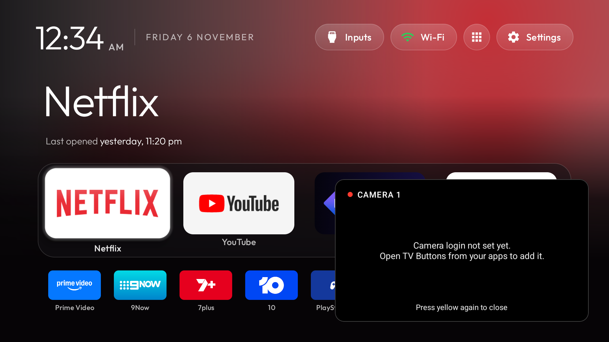

# 7. Camera overlay (Dahua / DMSS recorders)

Press a colour button and a live picture of a camera appears bottom-right, over whatever is on: Netflix, YouTube,
the PS5, Home. Press it again to close it; another camera's button switches. It never takes the remote's focus, so
the app underneath keeps working, and it's silent.

Tested on ours: two cameras (yellow, blue) at Home, over Netflix (which kept playing smoothly) and over the PS5 on
HDMI. About 3.5 s from button to picture.

## Why not just show HDMI 2 in a corner?

The recorder is already plugged into HDMI 2, but this TV has **one** HDMI picture path and **no picture-in-picture**
(no `android.software.picture_in_picture`; TCL's Multi View is absent). Showing HDMI 2 means switching the whole
screen, which is what the Stan button does. The overlay instead pulls the camera's network stream (RTSP) and
plays it like any app video, so it works over anything.

## What you need

1. **A recorder that serves RTSP.** Dahua recorders (the ones the DMSS app manages) do. The overlay asks for
   `rtsp://<recorder>:554/cam/realmonitor?channel=<n>&subtype=1`, the small "sub-stream" of channel n. Another brand?
   It's one line in `tv-buttons/.../CameraOverlay.java` (`play()`, the `url`), e.g. Hikvision
   `/Streaming/Channels/<n>02`. A eufy doorbell generally only streams through eufy's cloud, so it's out.
2. **The TV and the recorder on the same network, and not a guest Wi-Fi.** Ours was the trap: the TV (and the PC)
   were on the router's 2.4 GHz **guest** Wi-Fi. It hands out addresses in the same range, but walls guests off
   from everything else, the wired recorder included (no reply to anything, not even a ping). We moved both to the
   main network (the TV to 5 GHz, also better for 4K). Note: phones must be on the TV's network to cast to it.
3. **The recorder's address.** The DMSS app doesn't show it for recorders added by QR/serial (cloud), and the router
   app may not name it. The sure way: on the recorder's own screen (HDMI 2, with a USB mouse plugged into the
   recorder), right-click → **Main Menu → Network → TCP/IP**. Then **reserve that address** in the router so it
   never changes.
4. **A view-only account on the recorder**, so the TV never holds the admin password. On the recorder's screen:
   **Main Menu → Account → User → Add**: username e.g. `tv`, a password, group **User**, permission **Live** only
   (all cameras). Any characters work in the password.
5. **Sub-stream settings** (DMSS → device → Remote Config → Camera Settings → Video Stream → *Sub Stream*). Ours:
   H.265, D1 704×576, 12 fps, CBR 512 kbit/s, which plays fine (the TV decodes H.265 in hardware). Audio can stay on:
   the overlay never plays it. Leave "TLS Encryption" for RTSP off.
6. **Optional, on the PC:** VLC → Media → Open Network Stream →
   `rtsp://<recorder ip>:554/cam/realmonitor?channel=1&subtype=1`. VLC asks for the login (type it there, not in
   the address). If it plays, the recorder side is proven.

## Set it up on the TV

**App Library → TV Buttons** (it's hidden from Home by the theme) opens the setup screen:

- **Recorder address**, **Username**, **Password**: typed with the remote, by the owner. They're stored in TV
  Buttons' private storage, which other apps and the debugging connection can't read, and never logged.
- **One row per camera that a button shows**, with a name (shown on the overlay, e.g. BACKYARD) and a **Try** button
  that previews it.
- **Save.**

## Buttons for your cameras (how to expand)

The overlay shows **recorder channel numbers**: the numbers on the recorder's own camera list (channel 1 = its first
camera). Which buttons show which channels is in the mappings ([step 6](06-remote-buttons.md#your-own-buttons-no-rebuild-needed)):

| Mapping | Behaviour |
|---|---|
| `KEYCODE_PROG_YELLOW=camera:1` | yellow toggles channel 1 |
| `KEYCODE_PROG_BLUE=camera:2` | blue toggles channel 2 |
| `KEYCODE_PROG_RED=camera:3` | red toggles channel 3 |
| `KEYCODE_PROG_GREEN=camera:4` | green toggles channel 4 |
| `KEYCODE_PROG_BLUE=camera:1,2,3,4,5,6` | blue steps 1 → 2 → … → 6 → closed |
| `KEYCODE_PROG_YELLOW=camera:1,2,3,4` + `KEYCODE_PROG_BLUE=camera:5,6,7,8` | eight cameras on two buttons |

Rules: the same button again closes (or steps to the next camera of its list); a different camera button switches
straight to its first camera; the hint at the bottom says what the button does next ("Press blue for the next
camera"). The four colour buttons are free on a TV without an antenna. Any spare button works (Stan and Disney+
are mapped to inputs here, but could be cameras instead). After editing, push `mappings.txt`; the setup screen
then shows a name field and Try button for every channel you mapped.

## How it works

| Part | Detail |
|---|---|
| Window | An accessibility overlay of TV Buttons' service (`TYPE_ACCESSIBILITY_OVERLAY`): no extra permission, never focusable or touchable, 400×225 dp (16:9), bottom-right, rounded |
| Player | Google's **Media3** (ExoPlayer + RTSP), over **TCP** (steadier on Wi-Fi), **video only** (the audio track is never selected, so the TV's sound is untouched), short buffer for near-live |
| Picture | The D1 sub-stream is a 16:9 picture squeezed into 704×576; the 16:9 window un-squeezes it |
| Cost while open | about 13% of one core (≈3% of the TV), ~20 MB. Decoding runs on the video chip (`c2.mtk.hevc.decoder`) alongside Netflix's protected decoder. Nothing runs while closed |
| Closes | same button, standby (screen off), leaving the setup screen (previews) |
| Errors | "Can't reach the camera. Trying again…" every 5 s; after 3 failures it adds "Check the login in TV Buttons" |

**Why Media3 and not Android's built-in player:** we tried the built-in `MediaPlayer` first. It logged in and
started the stream, then got the H.265 picture size wrong ("287 × 0") and never started a decoder, so it was stuck
on "Connecting". Worse, TCL's verbose logging wrote the full stream address, **password included**, into the
system log. Media3 plays the stream and logs neither; TV Buttons logs only error codes.

## Troubleshooting

| Symptom | Likely cause |
|---|---|
| Stuck on "Connecting…" | wrong channel number; TV not on the recorder's network (guest Wi-Fi!); recorder address changed |
| "Can't reach the camera … Check the login" | wrong username/password, or the account lacks Live permission |
| Nothing appears on the button | the button's code differs on your remote (`record_keys.py`), or TV Buttons isn't running (step 6 check) |
| "Camera login not set yet" | open App Library → TV Buttons and fill it in |

Next: [8. Afterwards](08-maintenance-and-undo.md)
